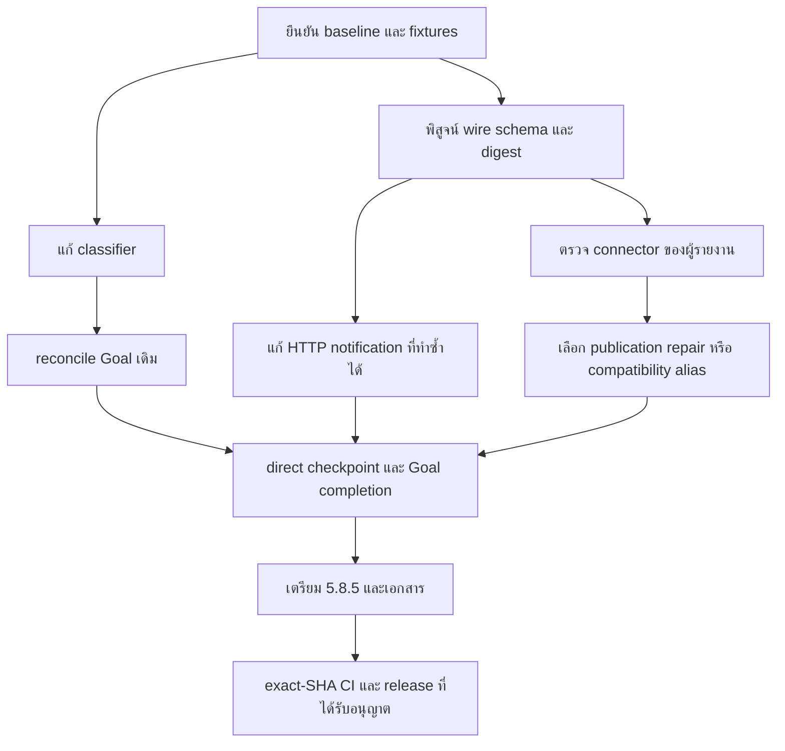

# lnwjud 5.8.5 Engineering Harness regression implementation plan

> **For agentic workers:** ใช้ `superpowers:executing-plans` เมื่อได้รับคำสั่งให้ลงมือทำแล้ว ทำตาม checkbox ทีละงานบน `dev` และอ่าน `AGENTS.md` ใหม่ก่อนเริ่ม เอกสารนี้ส่งมอบแผนก่อน implementation ตามคำขอของผู้ใช้

**Goal:** แก้การผูก delivery gates ให้กับงาน audit ที่ไม่ได้ขอ deploy กู้ metadata ของ Goal เดิมอย่างปลอดภัย และพิสูจน์ว่า direct `checkpoint_goal` ของ connector ที่มีปัญหารับ Engineering Gate fields ได้ครบใน 5.8.5

**Architecture:** ใช้ workflow classifier, ToolRegistry, Goal service, lease/CAS และ evidence verifier เดิม แก้การตีความคำสั่งและการ reconcile metadata ที่ authority เดิม ตรวจ schema และ refresh แยกตามขอบเขตของ MCP server, HTTP, gateway และ connector ไม่สร้าง Goal database หรือ schema registry อีกชุด

**Tech stack:** TypeScript, Node 24.x, pnpm 10.15.0, Electron/React, SQLite, `@modelcontextprotocol/server` และ `@modelcontextprotocol/client` 2.0.0, Zod 4.2.0, Vitest

**วันที่วางแผน:** 2026-10-13, Asia/Bangkok

**สถานะ ณ เวลาวางแผน:** ตรวจข้อเท็จจริงและ baseline แล้ว ยังไม่เริ่ม implementation หรือ version bump

**สถานะปัจจุบัน:** ผู้ใช้สั่งให้ดำเนินการตามแผนสำหรับ 5.8.5 แล้ว บันทึกหลักฐาน implementation และรายการ acceptance ที่ยังเปิดไว้ใน [Execution record](#18-execution-record-2026-10-13)

## 1. ขอบเขตและข้อกำหนดร่วม

- ทำงานบน `dev` ตาม [AGENTS.md](../../AGENTS.md) ไม่สร้าง branch หรือ worktree สำหรับงานนี้เอง
- ตอนส่งมอบแผนรอบแรก งานจำกัดอยู่ที่ MD เท่านั้น ภายหลังผู้ใช้สั่งให้ทำ implementation และเตรียม release 5.8.5 ต่อ รายละเอียดความคืบหน้าปัจจุบันอยู่ใน section 18
- 5.8.5 เป็นเป้าหมายการแก้ปัญหา Source และ public release ที่ตรวจในรอบนี้ยังเป็น 5.8.4
- Harness คง default Off และ Senior mode ต้องใช้งานต่อได้ ไม่แก้ปัญหาด้วยการปิด Harness หรือเปลี่ยนเป็น preset ที่ตรวจน้อยลง
- การจัดประเภทเป็นบริบทสำหรับ workflow ไม่ใช่ authorization ให้ commit, deploy, publish หรือเพิ่มสิทธิ์
- รักษา permission, Active Project, Full Bypass semantics, recovery, evidence verification, user-intent revision, lease ownership และ revision CAS
- Full Bypass ไม่ข้าม rolling Goal mutation fence และไม่ทำให้ required engineering gates ผ่านเอง
- ไม่เปิดให้ client ส่ง raw `engineering` metadata, gate definitions หรือ risk tier เพื่อแทน authoritative metadata
- ไม่แก้ SQL status โดยตรง ไม่ลบหรือสร้าง Goal ใหม่เพื่อหลบ completion checks
- ไม่เพิ่ม schedule สำหรับการวางแผน การแก้ classifier หรือการติดตาม CI การต่อ scheduled work ต้องมี authorization ของงานนั้นและใช้ workspace skill
- ไม่ติดตั้ง alias ใน `app.asar` ไม่ใช้ hotfix installer ของ 5.8.3 กับ 5.8.4 และไม่เปลี่ยน security gate เพื่อให้ patch ผ่าน
- Local Windows package ที่ไม่มี certificate ใช้ผล build และ SHA/provenance ตาม repository policy บันทึก `NotSigned` ตามจริง Official signing ที่ configured แล้วต้องคง gate เดิม
- ก่อนสรุปว่า issue ถูกแก้ ต้องมีหลักฐานของขอบเขตที่ issue รายงาน Unit tests หรือ connector ตัวอื่นใช้แทน fresh ChatGPT acceptance ไม่ได้
- Checkbox ในเฟสเป็น acceptance checklist ไม่ใช่ผลยืนยันโดยตัวมันเอง ให้ใช้ Execution record ท้ายเอกสารแยกสิ่งที่ตรวจผ่านและสิ่งที่ยังค้าง

## 2. Baseline ที่ตรวจจริง

| รายการ | ผล ณ เวลาวางแผน | ขอบเขตของหลักฐาน |
| --- | --- | --- |
| Workspace | `E:\lnwjud` | checkout ที่ตรวจในรอบนี้ |
| Branch และ HEAD | `dev`, `d5f4d6ab0a352ec2aa7d154068c78eaa6e9fe126` | ก่อนสร้างเอกสารแผน |
| Working tree ก่อนเริ่ม | clean | ไม่มี implementation change ที่ต้องรวมเข้ากับแผน |
| Root และ MCP package version | `5.8.4` | อ่าน package config ปัจจุบัน |
| Node และ pnpm | `24.16.0`, `10.15.0` | เวอร์ชันบนเครื่องนี้ |
| Public release | [v5.8.4](https://github.com/engasnm111/lnwjud/releases/tag/v5.8.4), public, non-prerelease | ตรวจ GitHub API ในรอบนี้ เผยแพร่ 2026-10-13 เวลา 09:33:20 Bangkok |
| Code intelligence | มี `.codegraph/` และใช้ CodeGraph ก่อนอ่านโค้ด | ส่วนที่ graph ไม่ครอบคลุมอ่านเฉพาะจุด |
| Application baseline | workflow และ preparation tests ผ่าน 11 tests ใน 2 files | tests เดิม ไม่ได้เพิ่ม regression test |
| MCP baseline | Goal tools, Engineering tools, evidence verifier และ availability tests ผ่าน 36 tests ใน 4 files | tests เดิม ไม่ใช่ installed หรือ ChatGPT acceptance |

คำสั่ง baseline ที่รันและ exit code เป็น 0 ทั้งสองคำสั่ง:

```powershell
corepack pnpm@10.15.0 --filter @lnwjud/application exec vitest run src/engineering/engineering-workflow.test.ts src/engineering/engineering-preparation-service.test.ts --fileParallelism=false
corepack pnpm@10.15.0 --filter @lnwjud/mcp-server exec vitest run src/tools/goal-tools.test.ts src/tools/engineering-tools.test.ts src/engineering-evidence-verifier.test.ts src/server-tool-availability.test.ts --fileParallelism=false
```

### 2.1 ปัญหาจากผู้รายงานและสิ่งที่ยืนยันได้

| ปัญหา | รายงาน | สิ่งที่ยืนยันในรอบนี้ |
| --- | --- | --- |
| [Engineering Harness incorrectly classifies read-only audit as deployment and leaves Durable Goals blocked](https://github.com/engasnm111/lnwjud/issues/194) | Full Audit กลายเป็น `unknown / medium / deploy` และ Goal เดิมติด delivery gates | ทำซ้ำกับ current workflow source ได้ พบทั้ง false deploy และกรณี negation กลืนคำสั่ง publish ที่อยู่ถัดไป |
| [lnwjud 5.8.4 Developer Release Fix Request / Engineering Gates + ChatGPT MCP Tool Schema](https://github.com/engasnm111/lnwjud/issues/198) | เซิร์ฟเวอร์มี Gate fields แต่ direct declaration ของ `mcp__lnwjud_CF` ไม่มี | Source มี fields และเส้น registration ใช้ schema เดิม พบ fields ใน probe ของ existing dist และ declaration ของสอง connector ในแชตนี้ สาเหตุของ CF connector ยังไม่ยืนยัน |
| Goal ของผู้รายงาน | Goal key `sd6-full-audit-risk-based-20261012`, ID `a210f8ca-6c41-425d-ab5c-5ad5cb746b80` ยัง active | เป็นข้อมูลจาก issue ไม่ได้อ่านหรือแก้ฐานข้อมูลของผู้รายงาน |
| Host-side tool rejection | บาง call ถูกบล็อกก่อนถึง lnwjud แม้ permission check allow | ยังไม่มีหลักฐานระบุ component ที่บล็อก ไม่สรุปว่าเป็น ACL, UAC หรือ Full Access |

ทั้งสอง issue ยัง open และไม่มี comments ณ เวลาที่อ่านในรอบนี้ รายละเอียดการติดตั้ง checksum และ alias ใน issue เป็นหลักฐานของผู้รายงาน ไม่ใช่ installed-state verification จากเครื่องนี้

### 2.2 การทำซ้ำ classifier

ใช้ TypeScript transpile current `engineering-workflow.ts` ในหน่วยความจำและเรียก exported functions ไม่เขียน source หรือ build ใหม่ Helper จาก `@lnwjud/shared` ใช้ existing dist จึงพิสูจน์ workflow logic ที่อ่าน ไม่ใช่ full current-SHA installation Objective เป็นตัวอย่างสังเคราะห์ เพราะ issue ไม่ได้ให้ objective เดิมครบถ้วน

| Objective ที่ทดลอง | ผลปัจจุบัน | ปัญหา |
| --- | --- | --- |
| `Full Audit; inspect source code and production read-only; no deploy requested` | `unknown / medium / deploy` พร้อม `exact_sha_ci`, `package` | ไม่รู้จัก Full Audit และถือ production เป็นการขอ delivery |
| `Local code review of source code` | `review / low / local` | ตัวควบคุมที่ทำงานถูกต้อง |
| `Review production; do not deploy` | `review / low / deploy` | คำ production ก่อนข้อห้ามยังทำให้ deploy |
| `Read-only code review of existing production deployments` | `review / critical / deploy` | topic ของ audit ยกระดับ risk และ delivery |
| `Read-only code review of the release from yesterday` | `release / critical / release` | historical release ถูกตีความเป็นคำสั่ง release |
| `Review code; do not deploy; commit the audit documentation` | `review / low / commit` | คำสั่ง commit หลัง separator ยังอยู่ |
| `Review code; do not deploy but publish a release` | `review / low / local` | negation ลบ affirmative publish ใน clause ถัดไป |
| `Review code; never deploy` แล้วขึ้นบรรทัดใหม่ `Publish a release` | `review / low / local` | newline ไม่สิ้นสุด negation ตาม logic ปัจจุบัน |
| `Perform code review and deploy production after approval` | `review / critical / deploy` | ต้องรักษา delivery gates และ approval ของคำสั่งจริง |

### 2.3 หลักฐาน MCP และข้อจำกัด

1. Current schema มี `engineeringGateUpdates` และ `engineeringReviewFindings` ทั้งคู่ Nested objects ใช้ strict schema และ arrays จำกัด 100 items
2. Current `defineTool` ใช้ schema เดียวสำหรับ validation และ advertisement `server.registerTool` รับ `tool.inputSchema` จาก registry โดยตรง
3. In-memory SDK probe ของ existing ignored dist ได้ 273 tools, `tools.listChanged=true`, fields ครบ และ `additionalProperties=false` ใน nested objects
4. Probe digest ของ `checkpoint_goal.inputSchema` คือ `ac8861bdc1d46582528cd6325ce4e6d74178d7274d478b69c2a85d4ffcc3e3ed` ใช้ recursive object-key sorting และคง array order ตัวเลขนี้เป็น probe result ไม่ใช่ release diagnostic contract
5. Dist ที่ probe ใช้มีไฟล์ลงวันที่ 2026-10-08 และ serverInfo รายงาน 5.8.4 ไม่ได้ build ใหม่จาก HEAD และไม่ใช่ archive ของผู้รายงาน ห้ามใช้ digest นี้เป็น expected value ของ 5.8.5
6. `mcp__codex_apps__lnwjud_pc_checkpoint_goal` และ `mcp__codex_apps__lnwjud_tunnel_notebook_checkpoint_goal` ที่ประกาศในแชตนี้มี fields ครบ เป็น declaration evidence เท่านั้น ไม่ได้เรียก mutation เพื่อยืนยัน
7. Modern localhost HTTP probe ที่ pin protocol `2026-07-28` พบ availability listeners เหลือ 0 หลัง request ปิด เปลี่ยน in-memory availability แล้วได้รับ notification 0 ครั้ง แต่ explicit fresh `tools/list` เห็นรายการใหม่ ผลนี้ใช้ existing dist เช่นกัน
8. HTTP probe พบช่องว่างการแจ้ง inventory changes ที่ lnwjud ควบคุมได้ ยังไม่พิสูจน์ว่าเป็นต้นเหตุที่ CF connector ละ Gate fields
9. Catalog serializer กับ SDK wire serializer ต่างกันเมื่อ schema มี defaults ตัวอย่าง `run_goal` ใน wire ต้องการ `workspaceId`, `goalKey` แต่ catalog ยังถือ `leaseSeconds`, `scheduledContinuation` เป็น required ด้วย `checkpoint_goal` ตรงกันใน probe นี้
10. ไม่มี `callTool`, Goal creation, installer mutation หรือการเปลี่ยน availability ที่บันทึกลง product settings ใน probes เหล่านี้

## 3. แผนที่การตัดสินใจแบบ wayfinder

### Destination

ได้แผนที่ผู้ลงมือทำสามารถแก้ทั้ง classification, existing Goal recovery และ direct MCP contract ของ 5.8.5 โดยรักษา gates และระบุ acceptance ที่ต้องยืนยันกับ connector จริง

### Notes

ใช้ local Markdown map ตามคำขอให้ทำ MD ก่อน ส่วน map เป็น index และรายละเอียดแต่ละ decision อยู่ใน ticket ด้านล่าง ไม่สร้าง GitHub map issue, child issue หรือ research branch ในรอบนี้ ใช้ชื่อ ticket ในลิงก์แทน bare issue IDs ทุก decision ด้าน implementation เป็นข้อเสนอรอคำสั่งลงมือทำ ไม่ใช่ความเห็นที่อ้างว่าเจ้าของงานอนุมัติแล้ว

ใช้ pstack:poteto-mode และ pstack:how สำหรับ source investigation ใช้ wayfinder แยก questions และ dependencies ใช้ writing-plans, technical-writing และ unslop จัดเอกสาร การตรวจ TypeScript ใช้ typescript-best-practices และ Type System Discipline

`throughput checkpoint: n/a, read-only investigation`

### Decisions so far

- [แยกคำสั่ง delivery ออกจากหัวข้อ audit](#decision-classification) พบ defect ใน current source และกำหนด repair boundary ที่ workflow layer
- [แก้ metadata ของ Goal เดิมผ่าน authority เดิม](#decision-goal-recovery) classifier fix อย่างเดียวไม่ refresh unchanged-policy Goal ต้อง reconcile ด้วย leased snapshot และ CAS
- [เปรียบเทียบ schema ที่แต่ละขอบเขต](#decision-schema-boundaries) server และ connector เป็น acceptance คนละรายการ CF cause ยังเปิดอยู่
- [แจ้งรายการเครื่องมือตามอายุ HTTP endpoint](#decision-http-notifications) มี owned notification gap ให้พิสูจน์จาก freshly built source ก่อนแก้
- [เลือก alias เมื่อ canonical publication ยังแก้ไม่ได้จริง](#decision-alias) ไม่เพิ่ม alias เป็นค่าเริ่มต้น มีทางเลือกที่คง canonical policy หาก live evidence บังคับให้ใช้

### Not yet specified

ผลกระทบจากขั้นตอน review ของ plugin publication จะกำหนดวันปิด live acceptance ได้เมื่อทราบ connector type และ snapshot ของผู้รายงานแล้ว ไม่ประมาณระยะเวลา review ของ host โดยไม่มีข้อมูล

### Out of scope

- เปลี่ยน transport protocol หรือ upgrade MCP SDK ทั้งชุดเพียงเพราะใช้ SDK v2
- สร้าง NLP service, LLM classifier หรือ policy engine ใหม่
- เปลี่ยน default Harness, อ่อน gate enforcement หรือเพิ่ม global not-applicable bypass
- กู้ production/customer Goal โดยแก้ SQL หรือ installed archive ระหว่างทำแผน
- ลบ/reconnect authentication, credentials หรือ connection ของผู้ใช้เป็นค่าเริ่มต้น
- ซ่อม host tool rejection ที่ไม่มี error origin โดยเดาสาเหตุ

### Dependency ของการลงมือทำ



## 4. Decision tickets และข้อเสนอ

<a id="decision-classification"></a>
### แยกคำสั่ง delivery ออกจากหัวข้อ audit

**Type:** `wayfinder:research` **สถานะ:** source question ตอบได้แล้ว ข้อเสนอ implementation ยังไม่ทำ

**Question:** classifier ต้องใช้ข้อมูลใดเพื่อให้ Full Audit ที่อ่าน production เป็น local และยังรักษาคำสั่ง release/deploy ที่ขอจริง

**Resolution จาก source:** `classifyEngineeringTaskKind` ไม่รู้จัก standalone Full Audit `inferDeliveryScope` ใช้ `production` หรือ `deploy` ที่เหลือหลัง regex ข้อห้าม ส่วน risk classifier อ่าน objective ทั้งก้อนก่อน review fallback ข้อห้ามเดิมหยุดที่ `;`, `,`, `.` จึงมีทั้ง false-positive และ false-negative

**ข้อเสนอ:** คำนวณ requested actions ใน pure workflow layer ก่อนใช้กับ task kind, risk และ delivery แยก current instruction, inspection topic, historical/quoted reference และ negated action ใช้ clause boundaries ที่ครอบคลุม newline และคำเชื่อม ไม่ใช้กฎว่า objective มีคำ audit แล้ว local เสมอ

รักษา exported signatures เดิม:

```ts
classifyEngineeringTaskKind(objective: string): EngineeringTaskKind
classifyEngineeringRisk(objective: string, taskKind?: EngineeringTaskKind): {
	readonly tier: EngineeringRiskTier;
	readonly reasons: readonly string[];
}
inferDeliveryScope(objective: string): EngineeringDeliveryScope
```

หากจำเป็นต้องรวมการวิเคราะห์ ให้ใช้ helper ภายใน `engineering-workflow.ts` ที่คืน task kind, risk, reasons และ delivery จากการตีความเดียวกัน ไม่เพิ่ม required MCP input เพื่อให้ bug fix ใช้งานได้

| ทางเลือก | ข้อดี | ข้อจำกัด | การเลือก |
| --- | --- | --- | --- |
| อ่าน affirmative requested actions ใน pure helper เดิม | แก้ทั้ง false deploy และ negation ไม่เพิ่ม external input dependency | ต้องกำหนด semantic cases จาก tests ให้ชัด | แนะนำ |
| เพิ่ม audit keyword แล้วลบ production trigger อย่างเดียว | diff เล็ก | history, quoted release และ mixed instructions ยังผิด | ไม่พอ |
| ให้ client ส่ง task kind/risk/delivery เอง | intent ชัดใน ideal caller | caller อาจ downgrade gate และต้องแก้ direct schema อีกชุด | ไม่ใช้เป็น authority |

คำว่า after approval สามารถทำให้ plan เตรียม deploy gates ได้ แต่การลงมือ deploy ยังต้องผ่าน approval แยกต่างหาก Delivery scope ไม่ใช่หลักฐานว่า approval ได้รับแล้ว

<a id="decision-goal-recovery"></a>
### แก้ metadata ของ Goal เดิมผ่าน authority เดิม

**Type:** `wayfinder:research` **สถานะ:** source question ตอบได้แล้ว

**Question:** จะกู้ Goal ที่เก็บ `unknown / medium / deploy` ไว้แล้วโดยไม่ให้ client ลบ required gates เองได้อย่างไร

**Resolution จาก source:** `engineering_start_task` refresh ปัจจุบันเมื่อ policy digest หรือ scoped path เปลี่ยน Objective/classifier output ไม่อยู่ใน policy digest การเปลี่ยน classifier จึงอาจไม่แก้ Goal เดิม `engineering_prepare_task` เป็น read-only ส่วน start ด้วย objective ใหม่และ key เดิมจะ conflict และ `revise_goal_intent` ไม่ได้ reclassify

**ข้อเสนอ:** เพิ่ม classification drift check ใน start/resume เดิม คำนวณ authoritative projection จาก stored objective และ policy/project ปัจจุบัน เปรียบเทียบ classification และ gate contracts กับ snapshot หลัง acquire lease แล้ว persist เฉพาะเมื่อ projection เปลี่ยน ใช้ Goal ID/key เดิมและ CAS เดิม

ให้เริ่มจาก projection comparison โดยไม่เพิ่ม SQLite schema หรือ persisted version field ถ้าพบว่าแยก legacy classification ไม่ได้จริง ให้เสนอ additive classifier revision พร้อม decoder/rollback tests ก่อนเพิ่ม field

กฎ reconcile ที่ต้องอยู่ใน implementation:

1. ใช้ `resumed.value.engineering` จาก snapshot ที่ acquire สำเร็จ ไม่ใช้ pre-acquisition `existingEngineering` เป็นฐาน merge
2. เปรียบเทียบ `requiredPlatforms` รวมใน gate contract ตาม semantic set ตลอดจน applicability, check command และ contract เดิม
3. Gate ที่ contract และ intent ยัง valid เก็บ status/evidence ไว้ Gate ใหม่หรือ contract เปลี่ยนคง pending/stale
4. Delivery gates ที่เกิดจาก classification ผิดหายได้เมื่อ authoritative replan ไม่กำหนดให้มีแล้ว ไม่รับ client ขอ `not_applicable` เพื่อข้ามข้อห้าม
5. รักษา project-required/security gates ที่ authoritative current plan ยังกำหนด ไม่ลบจาก gate ID อย่างเดียว
6. รักษา completed steps, acceptance, blockers, tracked tasks, user-intent revision, review findings และ recovery context โดยไม่แทน plan ของผู้ใช้ด้วย generated default
7. บันทึก old/new classification, เหตุผลและ gate diff ใน checkpoint/audit และเพิ่ม reconstruction facts ใน `resumeContext`
8. เรียกซ้ำแล้ว converge ไม่ checkpoint ซ้ำเมื่อ classification/contracts ไม่เปลี่ยน
9. Project opt-out ยังคง semantics เดิม ไม่ใช้ opt-out เป็นกลไกลบ metadata ของ active Goal
10. Objective ที่กำกวมยังต้องรายงาน ambiguity ห้ามให้ server สมมติ accepted user steering หรือเขียน objective ใหม่เอง

กรณีผู้รายงานต้องการเปลี่ยน scope จริงเป็นอีกเรื่องหนึ่ง ตรวจ durable accepted intent ก่อนออกแบบการเชื่อม `revise_goal_intent` เข้ากับ reclassification ไม่รับ arbitrary gate definitions เป็น intent correction

<a id="decision-schema-boundaries"></a>
### เปรียบเทียบ schema ที่แต่ละขอบเขต

**Type:** `wayfinder:research` **สถานะ:** repository path ตอบแล้ว CF publication question ยังเปิด

**Question:** Gate fields หายที่ serializer, endpoint, connector import, direct declaration หรือ argument forwarding

เส้นทางที่ยืนยันได้คือ `goalTools` → `defineTool` → registry envelopes → SDK `registerTool` → `tools/list` การเรียกใช้ SDK validation → `registry.invoke('checkpoint_goal')` → canonical parse → Goal service → evidence verification → lease/CAS

Remote OAuth gateway ใน source forward MCP body แบบ stream ไม่มี schema transformer ที่พบ แต่ยังต้องทดสอบ authenticated endpoint จริง ไม่สรุปว่า tunnel vendor หรือ ChatGPT catalog ภายนอกใช้ metadata สดแล้ว

| จุดตรวจ | หลักฐานที่จะเก็บ | เกณฑ์เลือกการแก้ |
| --- | --- | --- |
| Canonical Zod | properties, strict nested shape และ optionality | ถ้าขาดจึงแก้ canonical schema |
| SDK wire | `tools/list` response ทุก page จาก runtime ที่ freshly built | ถ้าขาดแต่ Zod มี ให้แก้ registration/serializer ที่ชั้นนี้ |
| HTTP/gateway/tunnel | response จาก route และ process เดียวกับ reporter | ถ้า wire ตรง แต่ endpoint ต่าง ให้แก้ route/catalog ownership |
| Connector imported declaration | tool name, server/build version, fields และ snapshot/review state ที่ host แสดงจริง | ถ้า endpoint มีแต่ declaration ไม่มี ให้ตรวจ import/transform/publication/cache โดยยังไม่ตั้งชื่อสาเหตุเอง |
| Invocation ingress | field-presence และ correlation ID ของ request ที่สังเกตใน route ที่ยืนยันแล้ว | ถ้าไม่มี request ให้ตรวจ upstream error origin และความครบของ observation ก่อน |
| Parsed Goal request | fields ที่ผ่าน strict parse แล้ว | ถ้า ingress มีแต่ parsed ขาด ให้แก้ parse/adapter |
| Durable readback | revision, gate status/evidence, findings และ unchanged fields | ถ้า parsed มีแต่ state ขาด ให้แก้ service/merge/storage |

Diagnostics ที่เสนอใช้ `appVersion`, build commit เมื่อทราบ, tool name, wire-schema SHA256, digest-format version, serialization target/input mode, transport/protocol เมื่อทราบ, availability generation, field-presence flags, observation time และ observation source ไม่เก็บ tokens, cookies, raw lease tokens หรือ evidence payload ของลูกค้า

ใช้ recursively sorted object keys, preserve array order, UTF-8 JSON และ SHA256 เป็นรูปแบบที่ระบุ version ชัด คำนวณจาก enriched schema ที่ SDK โฆษณา Serialize แบบ input mode และ draft เดียวกับ SDK ทดสอบว่า diagnostic schema เท่ากับ actual wire schema ห้ามใช้ tool-name hash หรือ schema registry version `1.0.0` เป็น schema freshness proof

ค่า connector digest หรือ negotiated protocol ที่อ่านไม่ได้ต้องเป็น unavailable ห้ามคัดลอก server digest ไปแสดงว่า connector digest เท่ากันแล้ว

<a id="decision-http-notifications"></a>
### แจ้งรายการเครื่องมือตามอายุ HTTP endpoint

**Type:** `wayfinder:research` **สถานะ:** static path และ existing-dist reproduction ตรงกัน ต้องยืนยัน current-source integration

**Question:** modern HTTP subscriber จะรับการเปลี่ยน tools inventory หลัง per-request server ถูกปิดได้อย่างไร

**Resolution:** `createSessionfulMcpHandler` มี modern handler และ event bus แต่ product ยังไม่มี endpoint-lifetime availability publisher Per-request `RegisteredTool.enable/disable` ใช้งานกับ in-memory/legacy connection แต่ subscription stream ของ modern SDK ใช้ shared bus หลัง product server ของ request ถูกปิด

**ข้อเสนอ:** subscribe availability ที่อายุ HTTP endpoint แล้วเรียก SDK `modernHandler.notify.toolsChanged()` เมื่อ effective exposed inventory เปลี่ยน ใช้ API ของ pinned 2.0.0 ที่ตรวจพบจริง ยกเลิก subscription หนึ่งครั้งตอน endpoint close และป้องกัน duplicate notification เมื่อหลาย requests เกิดพร้อมกัน

รักษา legacy HTTP และ STDIO behavior ตรวจ negotiated protocol ก่อนใช้ modern subscription acceptance ไม่เปลี่ยน protocol default เพื่อแก้ notification และไม่กล่าวว่า notification รับรอง ChatGPT import สำเร็จ

<a id="decision-alias"></a>
### เลือก alias เมื่อ canonical publication ยังแก้ไม่ได้จริง

**Type:** `wayfinder:research` **สถานะ:** conditional choice รอผล CF boundary probe

**Question:** 5.8.5 ต้องเพิ่ม `checkpoint_goal_engineering` หรือแก้ canonical connector publication ได้โดยตรง

**ข้อเสนอหลัก:** พิสูจน์และแก้ canonical `checkpoint_goal` ก่อน เพราะ source, SDK probe และสอง declarations ปัจจุบันมี fields แล้ว

ใช้ alias ต่อเมื่อ exact reporter connector ยังคงใช้ declaration ที่ขาด fields หลังขั้นตอน refresh/review ที่รองรับ และ canonical fix ส่งให้ host ใช้งานไม่ได้ทันรอบส่งมอบ Alias ต้องผ่าน fresh live session เช่นเดียวกัน ไม่สมมติว่าชื่อใหม่ย่อมข้าม cache ได้

หากเลือก alias:

- สร้างจาก canonical enriched schema/definition เดียว ไม่ duplicate validation หรือ Goal handler
- Dispatch ผ่าน `registry.invoke('checkpoint_goal', input, trace)` และรักษา canonical permission, availability, mutation classification, engineering preflight และ goalLease routing
- Alias ถูก hidden/disabled เมื่อ canonical tool ใช้งานไม่ได้ ไม่สร้าง per-alias override ที่เพิ่มสิทธิ์ได้
- Wrong receipt, workspace, revision, user-intent revision และ lease ต้องปฏิเสธเหมือน canonical และ state ต้องไม่เปลี่ยน
- แยก public tool name สำหรับ trace ได้ แต่ authoritative action และ receipt policy ยังเป็น canonical
- ทำ inventory count, tool docs และ tests ให้ตรงเฉพาะเมื่อเพิ่ม alias จริง เก็บ original tool เพื่อ backward compatibility
- ระบุ alias เป็น compatibility path และคง canonical publication acceptance ไว้ ไม่ปิด canonical defect ด้วย alias-only success

## 5. Source map สำหรับผู้ลงมือทำ

ลิงก์ต่อไปนี้อ้าง immutable baseline SHA ของแผน Line numbers เป็นจุดเริ่มต้น ต้องใช้ CodeGraph อ่าน current checkout อีกครั้งเมื่อ implementation เริ่ม

| ไฟล์หรือจุดเข้า | ความรับผิดชอบ | งานที่ต้องพิจารณา |
| --- | --- | --- |
| [engineering-workflow.ts](https://github.com/engasnm111/lnwjud/blob/d5f4d6ab0a352ec2aa7d154068c78eaa6e9fe126/packages/application/src/engineering/engineering-workflow.ts#L87) | task kind, risk, delivery และ gates | repair pure inference; preserve gate selection |
| [engineering-preparation-service.ts](https://github.com/engasnm111/lnwjud/blob/d5f4d6ab0a352ec2aa7d154068c78eaa6e9fe126/packages/application/src/engineering/engineering-preparation-service.ts#L36) | read-only preparation จาก assessment/policy | ทดสอบ full preparation โดยไม่สร้าง Goal |
| [engineering-policy.ts](https://github.com/engasnm111/lnwjud/blob/d5f4d6ab0a352ec2aa7d154068c78eaa6e9fe126/packages/application/src/engineering/engineering-policy.ts#L98) | effective policy digest | ไม่สรุปว่า unchanged digest แปลว่า classification สด |
| [engineering-tools.ts](https://github.com/engasnm111/lnwjud/blob/d5f4d6ab0a352ec2aa7d154068c78eaa6e9fe126/packages/mcp-server/src/tools/engineering-tools.ts#L32) | start/resume/reconcile/status | classification drift, acquired snapshot และ gate contracts |
| [goal-tools.ts](https://github.com/engasnm111/lnwjud/blob/d5f4d6ab0a352ec2aa7d154068c78eaa6e9fe126/packages/mcp-server/src/tools/goal-tools.ts#L119) | strict direct MCP input และ canonical handler | exact schema contract และ forwarding tests |
| [goal-continuation-service.ts](https://github.com/engasnm111/lnwjud/blob/d5f4d6ab0a352ec2aa7d154068c78eaa6e9fe126/packages/application/src/goal-continuation-service.ts#L1190) | apply gate evidence และ service completion | preserve verifier; เปลี่ยนเฉพาะเมื่อ regression ต้องใช้ |
| [domain engineering.ts](https://github.com/engasnm111/lnwjud/blob/d5f4d6ab0a352ec2aa7d154068c78eaa6e9fe126/packages/domain/src/engineering.ts#L59) | required gate exception contract | exact_sha_ci/package ยัง not-applicable ตามอำเภอใจไม่ได้ |
| [goal-repository.ts](https://github.com/engasnm111/lnwjud/blob/d5f4d6ab0a352ec2aa7d154068c78eaa6e9fe126/packages/storage/src/goal-repository.ts#L412) | transactional checkpoint, ownership/CAS และ DoD | restart, wrong owner และ no-mutation rejection tests |
| [server.ts](https://github.com/engasnm111/lnwjud/blob/d5f4d6ab0a352ec2aa7d154068c78eaa6e9fe126/packages/mcp-server/src/server.ts#L147) | SDK registration และ live RegisteredTool handles | wire tests; schema lifecycle only if runtime needs it |
| [http.ts](https://github.com/engasnm111/lnwjud/blob/d5f4d6ab0a352ec2aa7d154068c78eaa6e9fe126/packages/mcp-server/src/http.ts#L276) | legacy และ modern HTTP lifetime | endpoint-owned toolsChanged publication/cleanup |
| [tool-registry.ts](https://github.com/engasnm111/lnwjud/blob/d5f4d6ab0a352ec2aa7d154068c78eaa6e9fe126/packages/mcp-server/src/tool-registry.ts#L351) | enriched schema, serialization และ central invoke | input-mode consistency, read-only diagnostic DTO |
| [remote-mcp-controller.ts](https://github.com/engasnm111/lnwjud/blob/d5f4d6ab0a352ec2aa7d154068c78eaa6e9fe126/apps/desktop/src/main/remote-mcp-controller.ts#L597) | authenticated gateway forwarding | preserve schema/events; ไม่เปลี่ยน auth เพื่อ refresh |
| [tool-catalog-service.ts](https://github.com/engasnm111/lnwjud/blob/d5f4d6ab0a352ec2aa7d154068c78eaa6e9fe126/apps/desktop/src/main/tool-catalog/tool-catalog-service.ts#L180) | Desktop catalog schema | match wire input mode/defaults |

ไฟล์หลักที่แก้คาดว่าจะเป็น workflow, engineering tools, registry/diagnostics และ HTTP พร้อม tests ใกล้เคียง อย่าแก้ทุกไฟล์ในตารางเพียงเพราะเป็น dependency ข้อมูล/manifest ภายนอกจะเพิ่มเข้า file map เมื่อพิสูจน์ว่าอยู่ในความรับผิดชอบของ repository

## 6. Phase 0 ยืนยัน fixtures และ baseline ก่อนแก้

**Inputs:** issue ทั้งสอง, source SHA ปัจจุบัน, `AGENTS.md`, current MCP declarations

**Outputs:** reproducible failing cases, exact connector identity/type และรายการ acceptance แยกตามขอบเขต

- [ ] ตรวจ `git status`, branch และ HEAD ใหม่ Preserve user-owned changes ที่เกิดหลังแผนนี้
- [ ] อ่าน workflow/Goal/MCP source กับ existing tests ด้วย CodeGraph ตรวจว่าจุดเข้าและ signatures ยังตรงกับ section 5
- [ ] นำ semantic rows ใน section 2.2 เข้า regression tests และรันให้เห็น assertion mismatch ที่ตั้งใจ ไม่ใช้ exception จาก test setup เป็น red proof
- [ ] Capture schema ของ freshly built source ใน temp test runtime ไม่ใช้ old dist probe เป็น current-source contract
- [ ] ทำซ้ำ modern HTTP notification case ด้วย pinned SDK และ source ใหม่ โดยไม่เปลี่ยน product settings จริง
- [ ] เมื่อเข้าถึง reporter environment ที่ได้รับอนุญาตได้ ให้เก็บ objective เดิม, effective preset/project policy, Goal metadata/revisions และ latest checkpoint แบบ redacted
- [ ] ระบุว่า CF connection เป็น custom MCP, published plugin หรือ upstream proxy/catalog และใช้ endpoint/process เดียวกันในการเทียบ schema
- [ ] เก็บ exact input-validation error และ correlation หาก request ไม่ถึง lnwjud ตรวจ route และ logging coverage ก่อนตั้งชื่อ upstream cause

**Exit:** local defects มี deterministic reproductions ส่วน external connector ที่เข้าถึงไม่ได้ยังมี acceptance row เปิดอยู่ การไม่มี external access ไม่ขวาง classifier/Goal/wire/HTTP work ที่ทำได้

## 7. Phase 1 แก้ requested-action classification

**Files:** Modify `packages/application/src/engineering/engineering-workflow.ts` Test `packages/application/src/engineering/engineering-workflow.test.ts` และ `engineering-preparation-service.test.ts`

**Interfaces:** รักษา signatures ใน decision classification `planEngineeringWorkflow` ยังคืน `EngineeringWorkflowPlan` เดิม ห้ามให้ inference เพิ่ม authorization

- [ ] เพิ่ม failing tests ผ่าน exported functions และ complete workflow plan ตามตารางด้านล่าง ตรวจทั้ง values และ delivery gate presence/absence
- [ ] Replace broad delivery/negation interpretation ด้วย bounded requested-action analysis ใน workflow module เดิม
- [ ] ให้ standalone source/repository Full Audit ที่เป็น inspection ได้ `review` และ explicit delivery ที่ไม่มีใน request ได้ `local`
- [ ] ใช้ requested actions กับ risk triggers ที่บอก mutation/delivery ไม่ยกระดับจาก historical/topic phrase เพียงอย่างเดียว
- [ ] รักษาความเสี่ยงของ actual security, persistence, destructive, cross-platform และ project-required work ไม่ blanket downgrade เพราะมีคำ review
- [ ] รัน workflow/preparation tests ให้ผ่าน ตรวจ semantics ของ Standard, Senior, Strict และ Custom
- [ ] ตรวจ diff และ review ว่า clause handling ไม่เพิ่ม language parser/framework หรือ duplicated decision path

### Semantic regression matrix

| Request | Expected task/scope | Gate ที่ต้องตรวจ |
| --- | --- | --- |
| Full Audit ของ source และ existing production deployments | `review / local` | ไม่สร้าง `exact_sha_ci`, `package` จาก topic |
| Read-only production audit, explicitly no deploy | `review / local` | gate สำหรับ local review ยังอยู่ |
| Review historical release from yesterday | `review / local` | ไม่กลายเป็น release/critical จากประวัติ |
| Review deployment scripts / release pipeline | `review / local` | หัวข้อที่ตรวจไม่เท่ากับคำสั่งให้ปล่อย |
| Audit แล้วเขียนรายงาน ไม่ push/deploy | review ที่มี docs output, `local` | diff/docs ตาม scope จริง ไม่มี release proof |
| `ตรวจโค้ด production แบบอ่านอย่างเดียว ห้าม deploy` | `review / local` | Thai negation ไม่ปล่อย production trigger |
| `ตรวจสอบย้อนหลังการรีลีส ยังไม่ต้องปล่อยเวอร์ชัน` | `review / local` | historical Thai ไม่กลายเป็น release |
| Review, then commit report; do not deploy | `review / commit` | commit คงอยู่ ไม่เพิ่ม deployment gates |
| Review, do not deploy but publish a release | release requested, `release` | มี `exact_sha_ci`, `package` และ release risk |
| Never deploy แล้ว newline Publish a release | release requested, `release` | negation ไม่กลืน affirmative clause ใหม่ |
| Audit and fix authentication persistence bug | behavioral repair, `local` | security, persistence, integration ตาม actual scope |
| Review and deploy production after approval | deploy requested, `deploy` | required delivery gates และ approval แยก |
| Deploy to staging | `deploy` | ไม่ลด scope เพราะไม่ใช่ production |
| Publish version 5.8.5 | `release / release` | release gates ยังอยู่ |
| No deployment requested with ambiguous topic | `local` พร้อม explanation | ambiguity ไม่อนุญาต mutation |

ตัวอย่าง assertion ที่ตรวจ regression จริง:

```ts
import { expect, it } from 'vitest';
import {
	classifyEngineeringTaskKind,
	inferDeliveryScope,
} from './engineering-workflow.js';

it('keeps a production inspection local', () => {
	const objective = 'Full Audit; inspect source code and production read-only; no deploy requested';
	expect(classifyEngineeringTaskKind(objective)).toBe('review');
	expect(inferDeliveryScope(objective)).toBe('local');
});

it('retains an affirmative release after a deploy prohibition', () => {
	expect(inferDeliveryScope('Review code; do not deploy but publish a release')).toBe('release');
});
```

ใช้ existing assessment fixture เพิ่มการตรวจ `plan.gates` ด้วย independent expected gate IDs ไม่คำนวณ expected จาก helper ที่กำลังซ่อม

**Exit:** semantic matrix ผ่าน Actual deploy/release/security/persistence cases ไม่ถูกลด gate และ preparation ยังไม่มี side effects

## 8. Phase 2 กู้ existing Goal metadata อย่างปลอดภัย

**Files:** Modify `packages/mcp-server/src/tools/engineering-tools.ts` Test `engineering-tools.test.ts` และ `packages/storage/src/goal-continuation.integration.test.ts` เปลี่ยน application/domain/storage production code เฉพาะเมื่อ existing interfaces ไม่พอและมี regression ที่ระบุได้

**Consumes:** corrected `EngineeringWorkflowPlan`, authoritative policy/project assessment และ acquired Goal snapshot

**Produces:** Goal เดิมที่ metadata ตรง current classification โดยรักษาความคืบหน้าและ evidence ที่ยัง valid

- [ ] เพิ่ม fixture ของ active Goal ที่เก็บ `unknown / medium / deploy`, policy digest ไม่เปลี่ยน และมี completed steps/acceptance/context/findings อยู่แล้ว
- [ ] พิสูจน์ก่อนแก้ว่าการ resume ปัจจุบันยังเก็บ wrong metadata
- [ ] เพิ่ม projection drift detection ใน start/resume คำนวณจาก stored objective เดิม ไม่ reword objective เพื่อ acquire key เดิม
- [ ] Reconcile จาก acquired snapshot ตามกฎทั้งสิบข้อใน decision Goal recovery
- [ ] เพิ่ม current-snapshot race test เมื่อ metadata เปลี่ยนระหว่าง pre-read กับ acquire และทดสอบ `requiredPlatforms` เปลี่ยนแล้ว evidence ต้อง stale
- [ ] Persist ผ่าน `checkpointGoal` ภายใต้ current lease, revision และ intent checks เดิม เก็บ recovery context เดิมครบแล้วเพิ่ม correction facts
- [ ] Resume ซ้ำต้องไม่สร้าง checkpoint ที่ไม่มี semantic change ไม่ duplicate Goal และไม่ล้าง blockers/tracked tasks
- [ ] Close/reopen temporary storage แล้วอ่าน metadata/evidence/context กลับ ตรวจ JSON decoder compatibility
- [ ] Wrong revision, intent, client/session, expired token, lost CAS หรือ terminal Goal ต้องคืน rejection โดยไม่มี mutation
- [ ] ทดสอบ actual release Goal ว่ายัง require `exact_sha_ci`, `package` และไม่ให้ correction เป็นช่องทาง downgrade
- [ ] ทดสอบ corrected audit Goal completion หลัง applicable local gates ผ่านจริง และ blocking finding ที่ค้างต้องยังขวาง finish
- [ ] ทดสอบ native-cleanup flow แยก Correction ไม่สร้าง/disable/delete schedule และไม่ข้าม completion cleanup

คำสั่ง focused validation:

```powershell
corepack pnpm@10.15.0 --filter @lnwjud/mcp-server exec vitest run src/tools/engineering-tools.test.ts src/tools/goal-tools.test.ts --fileParallelism=false
corepack pnpm@10.15.0 --filter @lnwjud/storage exec vitest run src/goal-continuation.integration.test.ts --fileParallelism=false
```

**Exit:** unchanged-policy legacy Goal บน temp storage ถูกแก้บน ID/key เดิม มี checkpoint ที่ reconstruct ได้และผ่าน restart/negative tests ไม่ได้แก้ customer Goal ระหว่าง unit validation

## 9. Phase 3 พิสูจน์ direct MCP contract และ schema diagnostics

**Files:** Create `packages/mcp-server/src/server-tool-contract.test.ts` Modify tests ใน `goal-tools.test.ts`, `tool-registry` ที่ตรงการ serialize จริง และ `apps/desktop/tests/tool-catalog-runtime.test.ts` Reuse existing read-only tool-description/diagnostic route ไม่สร้าง schema registry ใหม่

**Consumes:** enriched ToolRegistry definition และ SDK 2.0.0 input serializer contract

**Produces:** real wire assertions และ read-only schema fingerprint ที่อธิบาย origin/format ได้

- [ ] ใช้ real SDK Client/Server fixture และอ่านทุก `tools/list` page ตรวจ `checkpoint_goal` ตาม exact canonical properties
- [ ] ตรวจทั้ง Gate fields, nested items, status/source/severity/state enums, array limit, optionality และ strict `additionalProperties` ไม่ตรวจแค่ string inclusion
- [ ] ตรวจ original fields `stepUpdates`, `trackedTasks`, `resumeContext`, revision/lease และ optional registry envelope ว่ายังถูกประกาศ
- [ ] เรียก direct SDK `callTool` บน isolated Goal fixture ตรวจ full forwarded arguments และ persisted readback ไม่หยุดที่ fake service ถูกเรียก
- [ ] ทำให้ catalog JSON Schema ใช้ input mode/target เดียวกับ SDK ตรวจกับ defaulted `run_goal` เพื่อไม่ให้ defaults กลายเป็น required
- [ ] เพิ่ม schema digest จาก canonical enriched wire input schema ลง existing read-only diagnostics/description output ใช้ DTO ที่ typed และ metadata ที่ bounded
- [ ] ทดสอบ object-key-order independence, changed nested field ทำให้ digest เปลี่ยน, array order ตาม contract และไม่มี timestamps/availability เข้า schema hash
- [ ] ทดสอบ diagnostic schema เท่ากับ wire schema และค่าที่ไม่ทราบเป็น unavailable ไม่ทำเป็น equal connector/server digest
- [ ] ตรวจว่า `tool_schema_register` หรือ name-only catalog hash ไม่ถูกใช้เป็น direct connector publication proof

ตัวอย่าง wire assertion ที่ต้องอยู่ใน fixture ของ new test file:

```ts
expect(checkpoint.inputSchema.properties).toHaveProperty('engineeringGateUpdates');
expect(checkpoint.inputSchema.properties).toHaveProperty('engineeringReviewFindings');
expect(checkpoint.inputSchema.properties.engineeringGateUpdates.maxItems).toBe(100);
expect(checkpoint.inputSchema.properties.engineeringGateUpdates.items.additionalProperties).toBe(false);
```

ใน test จริง parse SDK response ที่ boundary ให้ TypeScript รู้จัก object shape ก่อนเข้าถึง nested properties ไม่ใช้ `as` เพื่อข้าม validation และห้าม freeze digest ของ old dist เป็น expected 5.8.5 contract

**Exit:** freshly built source/wire/digest agreement ผ่าน Direct checkpoint บันทึกสอง fields และ existing recovery fields ได้ครบ External declaration acceptance ยังแยกอยู่

## 10. Phase 4 แก้ notification และทดสอบ gateway continuity

**Files:** Modify `packages/mcp-server/src/http.ts` Test `mcp-http.integration.test.ts`, `server-tool-availability.test.ts`, `apps/desktop/tests/remote-mcp-controller.test.ts` และ `tunnel-tool-catalog-continuity.test.ts` ใช้ existing tests ก่อนสร้างอีก framework

- [ ] เขียน source-backed modern subscription test ให้ล้มด้วย notification ที่ไม่มา แม้ explicit fresh list เห็น change
- [ ] เพิ่ม endpoint-lifetime availability subscription และ shared-bus publisher ตาม decision HTTP notifications
- [ ] Compare effective inventory ก่อน publish Debounce meaningful change โดยไม่ซ่อน schema update ที่เกิดจริง และไม่แจ้งซ้ำเมื่อ request เปิด/ปิดตามปกติ
- [ ] Validate modern subscribed client ได้ notification แล้ว fresh list เห็น correct inventory/fields
- [ ] Validate legacy HTTP และ STDIO ผ่าน existing RegisteredTool notification behavior
- [ ] Test multiple clients, reconnect, no-change update, endpoint shutdown, unsubscribe ครั้งเดียวและไม่มี callback หลัง close
- [ ] ผ่าน authenticated gateway ตรวจ schema และ subscription event body ไม่เปลี่ยน ตรวจ unauthorized request ยังถูกปฏิเสธ
- [ ] Tunnel listener restart ต้องให้ fresh listing/schema เดิมของ build นั้น และ expose app version/observation origin ตามจริง
- [ ] ถ้า metadata ของ registration ไม่เคยเปลี่ยนระหว่าง process อยู่ อย่าเพิ่ม runtime schema hot-reload framework ใช้ restart + supported client refresh ส่วน `RegisteredTool.update` ใช้เมื่อพิสูจน์ว่ามี owned in-process schema transition จริง

**Exit:** source integration พิสูจน์ notification gap ถูกแก้และ cleanup ไม่ leak ยังไม่อ้างว่า ChatGPT consumer import สำเร็จจาก notification count

## 11. Phase 5 ปิด connector acceptance ของผู้รายงาน

**Inputs:** exact endpoint ของผู้รายงาน, connector type, canonical schema digest และ freshly built candidate

**Outputs:** boundary-specific before/after evidence และ decision ว่าต้องใช้ alias หรือไม่

### เลือก refresh ตามประเภทที่ตรวจพบ

Custom MCP connection ใช้ restart/deploy server ที่ได้รับอนุญาตแล้ว กด Refresh ของ connection ตรวจ advertised metadata และเริ่ม conversation ใหม่สำหรับ affected tests ขั้นตอนนี้มาจาก [OpenAI refresh metadata](https://developers.openai.com/plugins/deploy/connect-chatgpt#refresh-metadata) ไม่ใช่ API ที่ lnwjud บังคับ host cache ได้

Published plugin ให้ตรวจ continuous tool review และ definition ที่ยัง live อาจเป็นรุ่นเดิมระหว่าง review การเปลี่ยน tool definition ไม่จำเป็นต้อง republish plugin ทุกครั้ง Submitted plugin information หรือ imported skills ใช้ draft/review/publication ที่ต่างกัน ตรวจตาม [OpenAI continuous review](https://developers.openai.com/plugins/deploy/app-review#continuous-review-and-tool-updates)

- [ ] Capture before/after declaration ของ `mcp__lnwjud_CF` เอง ไม่ใช้ declaration ของ lnwjud-pc/notebook แทน
- [ ] Verify nested contract ครบ ไม่เพียงเห็นสองชื่อ fields
- [ ] Direct checkpoint `docs_impact:not_applicable` พร้อม reason จริงต้อง persist และเพิ่ม revision ตามจำนวน successful checkpoints
- [ ] Direct checkpoint `integration:passed` พร้อม authenticated host receipt, matching workspace/runId และ exitCode 0 ต้อง persist
- [ ] บันทึก `engineeringReviewFindings` และอ่าน state/reason/severity กลับครบ รวม blocking finding ที่ยังต้องขวาง completion
- [ ] Invalid/mismatched runId, fabricated evidence source, wrong workspace, absent receipt, nonzero exitCode, stale revision/intent และ wrong/expired lease ต้อง reject และ revision/state ไม่เปลี่ยน
- [ ] Existing `stepUpdates`, `trackedTasks`, `resumeContext` ใช้ร่วมกับ Gate fields ได้ การ checkpoint ไม่ล้าง reconstruction state
- [ ] Required gates ที่เหมาะกับ actual task รวม review/security/CI/package เมื่อ applicable ต้องผ่านอย่างชอบธรรมก่อน `finish_goal(completed)`
- [ ] ถ้า direct canonical ผ่าน ไม่เพิ่ม alias ถ้ายังมี publication blockage ให้ใช้ conditional alias requirements และ rerun direct acceptance ทั้งชุด
- [ ] ถ้า live host บล็อกก่อน dispatch เก็บ exact error/action/route observation แล้วรายงาน external acceptance ยังไม่ผ่าน ไม่แก้ permissions ที่ไม่มีหลักฐานผิด

### Acceptance แยกตาม environment

| Environment | หลักฐานที่ต้องมี | สถานะในรอบวางแผน |
| --- | --- | --- |
| Current source classifier | synthetic reproductions | defect reproduced |
| Freshly built SDK wire | complete schema และ direct invocation/readback | ยังไม่รัน |
| Modern/legacy local HTTP | schema, relevant notifications, reconnect/cleanup | existing-dist modern defect observed; source fix ยังไม่ทำ |
| Authenticated remote gateway | schema/event passthrough และ auth rejection | source trace เท่านั้น |
| Secure Tunnel | exact route/build listing และ reconnect | ยังไม่ทดสอบ live |
| Real updated installation | updater จาก 5.8.4, runtime version/schema และ old Goal correction | ยังไม่ทำ |
| Fresh reporter CF conversation | full declaration, direct success/negative cases และ Goal closure | ยังไม่เข้าถึง |
| Current lnwjud-pc/notebook declarations | both fields advertised | พบแล้ว ไม่ใช่ invocation acceptance |
| Windows/macOS/Linux source/packaged CI | exact-SHA target proof | ไม่รัน hosted CI ในรอบนี้ |

**Exit:** ระบุชั้นที่เคยเสียและหลักฐานหลังแก้ได้ Direct original tool ผ่านใน reporter connector หรือ compatibility outcome ถูกแยกอย่างตรงไปตรงมา Canonical defect ที่ยังค้างไม่ถูกปิดเพราะ alias ผ่าน

## 12. Phase 6 เตรียม 5.8.5 และเอกสารเมื่อ functional work ผ่าน

**Files:** canonical version surfaces จาก `scripts/set-version.mjs`, `README.md`, `FULL_README.md`, `RELEASE_NOTES.md`, `docs/USAGE_TH.md`, tool-contract/catalog docs ที่ได้รับผล, `apps/desktop/src/renderer/features/release-notes/release-notes.ts`, `apps/desktop/src/renderer/i18n/messages.ts` และ release-notes tests

- [ ] Functional change และ deterministic regression ต้องเสร็จก่อน version bump
- [ ] ใช้ canonical script ก่อนแก้ current-version references ด้วยมือ รัน version contract ทันที

```powershell
corepack pnpm@10.15.0 run set-version 5.8.5
corepack pnpm@10.15.0 test:version
```

- [ ] Inspect diff และ current-version drift ถ้ามี reference ที่ script ครอบคลุมไม่ครบ ให้แก้ script ใน change เดียวกัน Preserve historical plans/evidence
- [ ] Current source เปลี่ยนเป็น 5.8.5 แต่ Current published/download links ยังเป็น 5.8.4 จนเผยแพร่และตรวจ assets แล้ว
- [ ] เพิ่ม exact-version in-app What's New 5.8.5 พร้อม meaningful Thai/English strings README/GitHub notes ไม่แทน modal registry
- [ ] Release copy ระบุ audit scope fix, safe Goal reclassification และ MCP contract diagnostics ตามที่ทำผ่านจริง ถ้า external acceptance ค้าง ห้ามใช้ copy ว่า ChatGPT ทุก connector ถูกแก้แล้ว
- [ ] READMEs มีสาม release highlights ล่าสุด ย้ายอันเก่าไป `RELEASE_NOTES.md` ไม่ลดรายละเอียด history
- [ ] Update usage recovery steps ให้ resume original objective/key และคง lease/CAS ถ้าทำ alias จริงให้ docs/counts ตรง registry-generated inventory
- [ ] Release tests ตรวจ exact current package version และ non-empty modal ผ่านก่อน tagging
- [ ] รัน full required local pre-push gate และ diff check

```powershell
powershell -NoProfile -NonInteractive -ExecutionPolicy Bypass -File scripts/verify-release.ps1 -SkipWindowsPackaging
git diff --check
```

**Exit:** version drift ไม่มี Source/published boundaries ถูกต้อง มี Thai/English modal และ full pre-push verification ไม่ใช้ targeted test อย่างเดียวแทน gate

## 13. Phase 7 ตรวจ exact-SHA delivery เมื่อได้รับ authorization

ทำตาม [Release process](../development/RELEASE_PROCESS.md) และ [Repository instructions](../../AGENTS.md) การขอแผนนี้ไม่ได้ authorize push/merge/tag/publish

- [ ] แยก functional repair กับ mechanical version sync ใน commits ที่ review ได้ ตรวจ final diff และ preserve งานของผู้ใช้
- [ ] เปิด/ใช้ `dev -> main` PR ตาม branch protection และผูก created/updated PR เข้ากับ chat ตาม host tools
- [ ] Resolve exact workflow run ID ก่อน monitor ตรวจ existing watcher แล้ว reuse ถ้าตรง run ใช้ authoritative `gh run watch <RUN_ID> -i 20 --exit-status`
- [ ] Confirm watcher terminal และ conclusion ของ exact SHA อย่าดูเพียง latest branch run
- [ ] ถ้า CI fail อ่าน exact job logs ซ่อมบน dev พร้อม deterministic regression ไม่ blind rerun หรือเพิ่ม timeout เพื่อซ่อน race
- [ ] Verify required Windows/macOS/Linux jobs และ target-native package matrix ตาม release process Evidence ของ OS หนึ่งไม่พิสูจน์อีก OS
- [ ] Merge protected PR แล้วรอ exact main SHA CI/package gates ของ merge commit ให้ terminal success ก่อน tag
- [ ] Verify SHA-scoped artifacts, hashes, provenance และ configured signatures ใช้ CI artifacts เดิม ไม่ rebuild ระหว่าง publication
- [ ] ก่อน publication ทดสอบติดตั้ง candidate package ของ exact main SHA บน isolated installation/data copy รวม existing misclassified Goal, restart/reconnect และ fresh direct schema ใช้ candidate installer/artifact โดยไม่อ้างว่า normal updater ผ่านแล้ว ไม่สร้าง updater feed ใหม่เพื่อการทดสอบนี้
- [ ] ทดสอบ rollback บน isolated installation/data copy ด้วย supported official path ยืนยัน old/new metadata decode ไม่มี state loss ห้ามสรุปว่า downgrade รองรับเพียงเพราะมี installer เก่า
- [ ] Publish/tag เฉพาะเมื่อ authorization และ prepublication acceptance ครบ ตรวจ actual assets/updater manifests หลัง workflow จบ
- [ ] หลัง public release พร้อมให้ normal updater ใช้งานแล้ว รัน update จาก clean 5.8.4 ไป 5.8.5 ใน isolated environment ตรวจ installed version/schema, existing Goal recovery และ reconnect/new-chat acceptance อีกครั้ง ถ้าล้มเหลวให้ถือ postpublication acceptance ยังไม่ผ่านและซ่อมผ่าน official release process ไม่แทนด้วยผล candidate installation
- [ ] หลัง public release verified ใช้ `node scripts/sync-published-docs.mjs v5.8.5 --apply` แล้ว `node scripts/sync-published-docs.mjs v5.8.5` เพื่อ no-change verification ส่ง docs follow-up ผ่าน dev/main process
- [ ] Sync dev ตาม release process และ cleanup temporary branches เฉพาะเมื่อไม่มี open PR/worktree/ownership ค้าง
- [ ] ถ้างาน implementation มี durable Goal ให้ checkpoint milestones และ finish/get_goal terminal ตาม workspace policy หากมี authorized native schedule ต้อง cleanup exact task ตาม skill ก่อนรายงาน complete

**Exit:** exact-SHA hosted proof, verified update/assets, documentation sync และ applicable live connector proof ครบ ประเด็น host ที่ยังยืนยันไม่ได้ต้องแสดงเป็น open acceptance แยก ไม่อ้าง release เท่ากับแก้ CF issue สำเร็จ

## 14. เงื่อนไขปิดแต่ละปัญหา

### ปิดการจัดประเภท audit และ Goal ค้าง

- [ ] Source/repository Full Audit ที่ไม่มี requested delivery เป็น review/local และไม่สร้าง CI/package gates จาก production/history topics
- [ ] Explicit commit, release และ deploy รวม mixed/Thai/newline cases ยังรักษาขอบเขตที่ขอและ gates ที่เหมาะสม
- [ ] Existing unchanged-policy Goal แก้ metadata ผ่าน supported start/resume บน ID/key เดิม มี durable correction evidence และ no repeated churn
- [ ] Completed work, acceptance, findings, context และ valid evidence ไม่สูญหาย
- [ ] Wrong owner/revision/lease และ attempt downgrade actual release/security/project contract ถูก reject โดยไม่มี mutation
- [ ] Corrected Goal complete ได้เฉพาะเมื่อ applicable gates ผ่านจริง และ blocking findings/tasks/native cleanup ไม่มีค้าง

### ปิด direct Engineering Gate schema

- [ ] Original `checkpoint_goal` wire schema จาก freshly built source และ real updated installation มีทั้ง fields/nested rules
- [ ] Reporter connector fresh session ประกาศ fields ครบหลัง supported refresh/review
- [ ] Direct original call รับ valid evidence/findings และอ่าน durable state กลับได้ ไม่ต้องใช้ tool_batch
- [ ] Adversarial evidence/lease/revision calls reject โดยไม่มี mutation
- [ ] Schema diagnostic มี defined format และ origin ไม่ใช้ name-only catalog hash แทน schema hash
- [ ] HTTP relevant notifications/reconnect/cleanup ผ่านตาม protocol ที่ใช้จริง
- [ ] If alias shipped, alias compatibility ผ่านแยก และ original-tool acceptance ที่ยังไม่ผ่านยังเปิดอยู่

## 15. ความเสี่ยงและสิ่งที่ต้องให้ความสำคัญในการ review

| ความเสี่ยง | Regression หรือข้อจำกัดที่ใช้ควบคุม |
| --- | --- |
| Read-only rule กลบ real deployment หรือ security repair | mixed affirmative/negative cases และ actual behavioral gate assertions |
| Negation scope กว้างจนกลืนคำสั่งถัดไป | but/newline/Thai separator cases |
| Reclassification ลบ valid evidence หรือ blocking findings | acquired-snapshot merge, contract comparison, restart/readback และ negative DoD tests |
| policy digest เดิมทำให้ Goal เก่าค้างต่อ | unchanged-policy legacy metadata fixture |
| Alias กลายเป็น permission/lease bypass | canonical dispatch/availability binding และ identical rejection/no-mutation tests |
| Digest วัด serializer คนละ mode หรือ release คนละชุด | input-mode/default fixtures และ actual tools/list comparison |
| HTTP listener leak หรือ duplicate notifications | endpoint lifetime, multiple-client และ shutdown tests |
| Upstream host ยังใช้ metadata snapshot เก่า | exact connector publication status, metadata confirmation และ new conversation |
| ใช้ old dist/local tests แทน installed acceptance | แยก source, built, installed, gateway และ ChatGPT rows |
| Host-side block ถูกวินิจฉัยผิดว่าเป็นสิทธิ์ของ Windows | correlation/route/error-origin evidence ก่อนเปลี่ยน permission |

หลักการ pstack ที่เปลี่ยนการตัดสินใจในแผนนี้:

- Fix Root Causes ทำให้แก้ inference และ persisted metadata ร่วมกัน ไม่ใช้การปิด Harness แทน
- Boundary Discipline ทำให้ตรวจ schema loss แยกแต่ละ boundary และคง strict validation ที่ ingress
- Laziness Protocol ทำให้ใช้ start/resume และ registry เดิม เลือก alias เฉพาะเมื่อจำเป็น ไม่สร้างอีกระบบ
- Test Behavior, Not Implementation ทำให้ negative tests ตรวจ revision/state ที่ไม่เปลี่ยน และ success tests ตรวจ persisted evidence/Goal closure
- Type System Discipline ทำให้ diagnostic DTO derive จาก authoritative schema และไม่ใช้ arbitrary client metadata เป็น authority
- Prove It Works ทำให้ real updated installation และ reporter fresh session เป็น acceptance ที่ยังต้องทำ ไม่ใช้ probe digest หรือ 47 baseline tests เป็น completion proof

## 16. แหล่งอ้างอิงและส่งต่องาน

- [Issue การจัดประเภท audit และ Goal ค้าง](https://github.com/engasnm111/lnwjud/issues/194)
- [Issue direct Gate schema ใน 5.8.4](https://github.com/engasnm111/lnwjud/issues/198)
- [MCP tools สำหรับ revision 2025-11-25](https://modelcontextprotocol.io/specification/2025-11-25/server/tools)
- [MCP tools สำหรับ revision 2026-07-28](https://modelcontextprotocol.io/specification/2026-07-28/server/tools)
- [MCP notifications เป็นทางเดียว ไม่มี response acknowledgment](https://modelcontextprotocol.io/specification/2026-07-28/basic#notifications)
- [SDK v2 protocol-version behavior](https://ts.sdk.modelcontextprotocol.io/v2/protocol-versions.html)
- [SDK subscriptions](https://ts.sdk.modelcontextprotocol.io/v2/clients/subscriptions.html)
- [OpenAI custom MCP metadata refresh](https://developers.openai.com/plugins/deploy/connect-chatgpt#refresh-metadata)
- [OpenAI continuous tool review](https://developers.openai.com/plugins/deploy/app-review#continuous-review-and-tool-updates)
- [OpenAI imported MCP tools ใน Responses API](https://developers.openai.com/api/docs/guides/tools-connectors-mcp#step-1-listing-available-tools)

MCP SDK version ไม่ใช่หลักฐานของ protocol ที่ connector เจรจาจริง และ Responses API imported-tool behavior ไม่ใช่หลักฐานว่า ChatGPT cache ใช้ implementation เดียวกัน ไม่มี official source ที่ตรวจพบระบุ callable lnwjud API สำหรับบังคับล้าง ChatGPT schema cache หรือรับการยืนยันว่า model context รับ schema ใหม่แล้ว

คำแนะนำนี้เป็น handoff ณ เวลาส่งมอบแผนก่อน implementation และถูกแทนที่ด้วยคำสั่งผู้ใช้ภายหลัง ให้อ่านสถานะล่าสุด, หลักฐาน และ next action จาก section 18 ก่อนทำงานต่อ

## 17. Attention ณ เวลาทบทวนแผน

reviewed by gpt-6-astra

ตรวจอิสระเฉพาะแผนและ decision trail แล้ว ข้อพบเรื่อง candidate updater sequence ถูกแก้เป็น prepublication installation กับ postpublication normal update แยกกัน และเพิ่ม/supersede evidence pointers ของผล tests, negation, old dist, HTTP, serializer และ compatibility decisions โดยรักษาประวัติเดิม ตรวจ pointer ของ minor finding แล้ว

รายการต่อไปนี้เป็นความเสี่ยงที่พบก่อน implementation:

- Cause ของ CF connector ยังไม่ยืนยัน ต้องตรวจ fresh reporter declaration และ direct invocation/readback ตาม Phase 5
- Current-source fix และ installed acceptance ยังไม่ได้ทำ 47 baseline tests กับ old-dist probes ไม่ใช่หลักฐานว่า 5.8.5 แก้บัคแล้ว
- Normal updater acceptance ต้องเกิดหลัง release พร้อมให้ updater พบได้ Candidate installer smoke เป็นหลักฐานอีกชนิดหนึ่ง

## 18. Execution record (2026-10-13)

ผู้ใช้สั่งให้ทำแผนนี้ต่อสำหรับ 5.8.5 หลังส่งมอบเอกสาร การตรวจด้านล่างเป็นหลักฐานจาก source ใน checkout ปัจจุบัน ไม่ใช่หลักฐานจาก installation ของผู้รายงาน, Cloudflare connector, hosted CI หรือ artifact ที่เผยแพร่แล้ว

### ผล implementation ใน source

- **Phase 1 — requested-action classification: ผ่านใน source หลัง independent-review regressions.** Workflow แยกหัวข้อ audit/history และข้อห้ามออกจาก affirmative delivery actions, จัดการ clause/newline boundaries, จับคู่ชื่อ environment จริงเพื่อไม่ให้การห้าม preview กลบ staging, ตรวจ ambiguity ของ `test`/`stage` ทั้ง target แรกและ target ต่อเนื่อง, และคง Thai read-only review ของ production deployment ไว้ใน local scope. เพิ่ม regression matrix ใน `packages/application/src/engineering/engineering-workflow.test.ts`.
- **Phase 2 — existing Goal metadata: ผ่านใน source หลัง scope-change regression.** Reconcile จาก Goal snapshot ที่ acquire ภายใต้ lease แม้ policy digest ไม่เปลี่ยน ตรวจ drift ของ classification และ required-gate contract รักษา findings, tracked tasks, evidence และ resume context ที่เข้ากันได้, ใช้ scope ของ Goal ที่ acquire จริงเมื่อ implicit scope เปลี่ยนระหว่าง lease acquisition, เปรียบเทียบ platform requirement แบบ set, stale gate evidence ที่ผูกกับ source scope เมื่อ scope เปลี่ยน, และเอาเฉพาะข้อความ pendingValidation ที่สร้างจาก Engineering gate เดิมออกก่อนสร้างรายการปัจจุบันใน `packages/mcp-server/src/tools/engineering-tools.ts`.
- **Phase 3 — direct local schema and durable write/readback: ผ่านใน source พร้อมข้อจำกัดภายนอก.** SDK Client/Server test ตรวจ optional strict Gate fields จาก wire `tools/list`. `tool_describe` อ่าน schema จาก ToolRegistry จริงและคืน canonical SHA-256, app version, origin, publication target, input mode, เวลาเก็บค่า และ presence ของสอง fields; connector schema ถูกระบุเป็น `unavailable` พร้อม digest `null`. CLI regression เรียก `checkpoint_goal` โดยตรงผ่าน MCP SDK ไปยัง runtime และ SQLite จริง ตรวจ durable readback หลังแทน runtime และยืนยันว่า malformed gate update ไม่เปลี่ยน revision/state. เครื่องมือ registry-only จะถูกอธิบายได้เมื่อ host เปิดใช้เท่านั้น. Connector ของผู้รายงานยังไม่มีหลักฐาน.
- **Phase 4 — modern HTTP inventory: ผ่านใน source.** Endpoint-lifetime availability subscription ส่ง `notifications/tools/list_changed`, client ดึง inventory ใหม่แล้วเห็น state ล่าสุด และ subscription ถูก cleanup เมื่อ endpoint ปิด. การผ่านนี้มาจาก local SDK integration test.
- **Phase 5 — connector/gateway: ค้าง.** Fresh Cloudflare declaration, actual direct invocation, persisted readback, gateway continuity และ ChatGPT refresh/reconnect ยังไม่มีหลักฐานจาก environment ของผู้รายงาน สาเหตุ Cloudflare transformation/cache จึงยังไม่ยืนยัน และ Issue #198 ห้ามสรุปว่าถูกแก้ครบ.
- **Phase 6 — version/docs: ส่วน source เสร็จ.** Canonical script ตั้ง source เป็น 5.8.5; เพิ่ม Thai/English in-app What's New, README highlights, release notes และคำแนะนำ resume Goal. Published version/download links ยังคง 5.8.4 จนมี release assets ที่ยืนยันแล้ว. `test:version` ผ่าน 5 tests; release-note/i18n tests ผ่าน 20 tests.
- **Phase 7 — local release verification: passed.** The full verifier passed on source version 5.8.5 after the classifier, scope-gate, and version changes. It passed the application suite (315/315), MCP suite (1,403 passed, 3 skipped), CLI suite (33/33), Desktop suite (837/837), acceptance (39/39), integration (2/2), Electron E2E (18/18), packaging contracts (82/82), and release gates (34/34). Lint, typecheck, builds, tool-catalog check, and `git diff --check` also passed. Windows packaging was skipped with `-SkipWindowsPackaging`. Hosted CI, main merge, official package/provenance, tag, publication, updater acceptance, and Cloudflare connector acceptance remain open.

### Local validation ล่าสุด

| คำสั่ง | ผล | ขอบเขต |
| --- | --- | --- |
| `corepack pnpm@10.15.0 --filter @lnwjud/application test` | 42 files, 315 passed | Current source unit/integration tests |
| `corepack pnpm@10.15.0 --filter @lnwjud/mcp-server test` | 86 files, 1,403 passed, 3 skipped | Current source suite after the near-limit checkpoint regression fix |
| `corepack pnpm@10.15.0 --filter @lnwjud/cli test` | 10 files, 33 passed | Direct MCP SDK call and CLI runtime tests |
| `corepack pnpm@10.15.0 --filter @lnwjud/desktop test` | 129 files, 837 passed | Desktop unit and integration tests |
| `corepack pnpm@10.15.0 run test:acceptance` | 6 files, 39 passed | Desktop host acceptance |
| `corepack pnpm@10.15.0 run test:integration` | 2 files, 2 passed | Cross-package MCP and review flows |
| `corepack pnpm@10.15.0 run test:e2e` | 18 passed | Electron UI acceptance |
| `corepack pnpm@10.15.0 --filter @lnwjud/application typecheck` | exit 0 | Application package |
| `corepack pnpm@10.15.0 --filter @lnwjud/mcp-server typecheck` | exit 0 | MCP server package |
| `corepack pnpm@10.15.0 --filter @lnwjud/desktop typecheck` | exit 0 | Desktop project references |
| `corepack pnpm@10.15.0 run test:version` | 5 passed, 18 skipped | Canonical version contract |
| Release notes, series, i18n tests | 20 passed | Localized exact-version What’s New and newest-three README contract |
| `git diff --check` | exit 0 | Only Git LF-to-CRLF normalization warnings were printed |
| `corepack pnpm@10.15.0 run test:packaging` | 10 files, 82 passed | Packaging and trust contracts |
| `corepack pnpm@10.15.0 run test:release-gate` | 4 files, 34 passed | Release gate and asset contracts |
| `powershell -NoProfile -NonInteractive -ExecutionPolicy Bypass -File scripts/verify-release.ps1 -SkipWindowsPackaging` | exit 0 | Full local release gate; native Windows packaging was explicitly skipped |

### Resume state

- Checkout อยู่บน `dev` หลัง commits `a0a112ef` (regression tests) และ `6176f3ec` (source fix). Version/docs diff สำหรับ 5.8.5 ยังไม่ commit. Independent whole-diff review ไม่มี findings ค้าง. Full verifier ผ่าน exit 0 หลังแก้ release-note counts เป็น 315/1,403.
- ก่อน push ให้ยืนยัน `test:version`, full `verify-release.ps1 -SkipWindowsPackaging`, `git diff --check` และ final diff. เวอร์ชัน contract และ full verifier ผ่านบน code/release-note diff ล่าสุด; Windows packaging ถูก skip ตาม option. จากนั้น commit version/docs แยกจาก functional commits, push `dev`, เปิด PR `dev` → `main`, และยืนยัน exact-SHA hosted CI ก่อน guarded merge.
- ก่อน release ยืนยัน Windows/native packaging, SHA-256/provenance, exact main SHA/hosted CI และ release assets; signing แยกจาก integrity ตาม repository policy. หลังเผยแพร่ต้องทดสอบ normal updater จาก clean 5.8.4 installation และ sync published docs.
- Issue #194 จะปิดได้เมื่อ source repair และ exact delivery gates ผ่าน. Issue #198 ยังคงเปิดจน external connector declaration/direct invocation/readback และ refresh acceptance ได้รับการพิสูจน์หรือมีผลสรุปที่ผู้ใช้รับทราบ.

Review นี้ไม่ใช่ implementation review หรือ release approval ความหลากหลายของ reviewer จำกัดอยู่ในตระกูล GPT ที่มีให้ใช้
